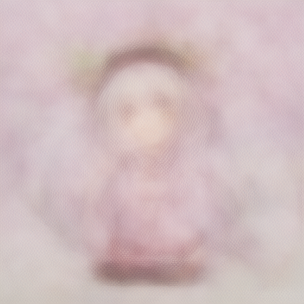

# Anima-compatible BF16 checkpoints on AMD XDNA 2

## Scope and claim

This repository demonstrates Anima Base v1.0, Turbo V1.1, and the WAI Nova
Anima Turbo LoRA Ver V1.0 full checkpoint with their 28 DiT transformer
blocks accelerated on AMD XDNA 2 through Triton-XDNA and XRT.
Safetensors remain the read-only source of truth. No ONNX conversion, Vitis AI
Execution Provider, or converted distributable model is used.

The pipeline is CPU-hybrid. XDNA runs the expensive Linear and QK/AV GEMMs;
Qwen, patch/time/RoPE preparation, normalization, softmax, GELU, residuals,
final projection/unpatchify, sampling, and VAE decoding remain on the CPU.
“GPU-free primary DiT acceleration” therefore does not mean “NPU-only image
generation.” A display GPU may be active independently.

As of 2026-10-02, searches of public GitHub code and the general web for
combinations of Anima, XDNA/XDNA 2, and Triton-XDNA did not find another
Anima-specific end-to-end demo. The searches did find generic Triton-XDNA
kernel examples in [AMD's Triton-XDNA repository](https://github.com/amd/Triton-XDNA)
and non-Anima [Ryzen AI Stable Diffusion demos](https://ryzenai.docs.amd.com/en/latest/sd_demo.html).
This dated, non-exhaustive search is not an absolute novelty claim.

## Validated matrix

| Component | Validated value |
|---|---|
| Processor/NPU | AMD Ryzen AI 9 365 / Strix XDNA 2 |
| NPU target | `npu2` / AIE2P |
| Windows Python | 3.13.9 |
| PyTorch | 2.14.1+cpu |
| Triton-XDNA | 3.6.0.2026093004+75679dc |
| XRT SDK | 2.21.75 |
| ComfyUI | `170594057a22673349ddf0a3d88624b7fa5865bb` |
| Wrapper source | `737338d76bf2a7dcf9806aaba5d6d936499b95ab` |
| Models | Anima Base v1.0, Turbo V1.1, and WAI Nova Anima Turbo LoRA Ver V1.0, BF16 transformer |
| Shape | batch 1, latent `[1,16,1,64,64]`, 512×512, context `[1,512,1024]` |

The exact structured measurements and artifact digests are in
[`evidence/anima-xdna-validated.json`](evidence/anima-xdna-validated.json).
Unless explicitly labeled as Q/K/V-chained, the historical measurements below
describe the pre-chaining resident runtime (23 dispatches/block); the current
default is 19 dispatches/block and is recorded in the final optimization
milestone.

## Architecture and model files

The ComfyUI wrapper replaces the block loop after native patch embedding,
timestep/AdaLN setup, Qwen adaptation, and RoPE preparation, and before the
native final layer and unpatchify. The resident runtime keeps XRT device,
contexts, kernels, weights, and reusable BOs alive across denoising steps.
The current default performs 19 dispatches per block and 532 for all 28;
`qkv_chaining=false` selects the earlier 23/644 comparison path.

Base may use two different files:

1. Native ComfyUI `anima-base-v1.0.safetensors`, selected in `UNETLoader`.
2. Diffusers Base transformer `transformer/diffusion_pytorch_model.safetensors`,
   entered in `Load/Attach Anima XDNA Model`.

The second file supplies exact block weights to the packed cache. It does not
replace the native ComfyUI checkpoint. Model weights are not included here.
Review the model licenses and obtain both files from their authorized source.

Turbo uses its full native V1.1 checkpoint for both `UNETLoader` and the XDNA
`checkpoint` input. Supported schemas are Diffusers `transformer_blocks.*`,
native Base `net.*`, and native Turbo `model.diffusion_model.*`. The wrapper
computes a canonical full digest of ordered key, dtype, shape, and every byte
of all 560 consumed tensors. MODEL/source disagreement is rejected before XRT
opens or any weight BO is populated; Base and Turbo packed payloads cannot be
mixed. The validated canonical fingerprints are
`083d6f88949dec38ec35579dfd16ae96f4d453074b4fdfb6c0ed965c9cd76757`
for Base and
`066b4281037504b1b7200ecd65b4182fc765ed882ecd5ca650db7308246a8dee`
for Turbo.

## Isolated Windows setup

Use an ASCII-only user path for ComfyUI and compiler caches. Do not modify an
existing ComfyUI Desktop installation.

```powershell
py -3.13 -m venv <XDNA_VENV>
& <XDNA_VENV>\Scripts\python.exe -m pip install --upgrade pip
# Install official AMD/Xilinx Triton-XDNA, MLIR-AIR/AIE, LLVM-AIE and
# ABI-compatible pyxrt wheels as described in anima_xdna_poc/README.md.
$env:XRT_DEV_DIR = "<XRT_SDK_DIR>"
& <XDNA_VENV>\Scripts\python.exe -m pip install torch --index-url https://download.pytorch.org/whl/cpu
& <XDNA_VENV>\Scripts\python.exe -m pip install -e "<THIS_REPOSITORY>"

git clone https://github.com/comfyanonymous/ComfyUI.git <COMFYUI_ROOT>
git -C <COMFYUI_ROOT> checkout 170594057a22673349ddf0a3d88624b7fa5865bb
# Install only missing ComfyUI requirements; do not replace the validated
# torch/Triton-XDNA stack.
```

Place a clone or directory junction of this repository under
`<COMFYUI_ROOT>\custom_nodes\anima-xdna-comfyui`. Copy
[`../examples/extra_model_paths_anima_xdna.yaml`](../examples/extra_model_paths_anima_xdna.yaml)
to a user-owned location and replace its placeholders. Never edit a
Desktop-generated model-path file for this setup.

```powershell
.\examples\run_comfyui_xdna.ps1 `
  -ComfyUIRoot "<COMFYUI_ROOT>" `
  -XDNAVenv "<XDNA_VENV>" `
  -XRTDevDir "<XRT_SDK_DIR>" `
  -ModelPathsConfig "<USER_MODEL_PATHS_YAML>" `
  -Port 8190
```

The launcher binds only `127.0.0.1`, uses ComfyUI CPU host mode, and forwards
additional arguments. The XDNA runtime remains available through
`XRT_DEV_DIR`, Triton-XDNA, and `pyxrt`.

## ComfyUI wiring

Use `Anima XDNA 2 / Load Anima (BF16)` to load the native Base or Turbo model,
then insert
`Anima XDNA 2 / Load/Attach Anima XDNA Model` between its MODEL output and the
normal sampler MODEL input. Leave `checkpoint` at `Auto (from MODEL)` to reuse
the exact read-only source recorded by the BF16 loader. A manual path remains
available for compatible MODELs loaded elsewhere and is still subject to the
same full fingerprint check. Leave `rebuild_cache=false`; leave `cache_dir` empty for
`%USERPROFILE%\.cache\anima-xdna\weights`, or use another user-owned ASCII
directory. Connect the wrapped MODEL to `Anima XDNA Runtime Status` when
collecting evidence. `Unload Anima XDNA Runtime` releases the attachment
before a model switch.

Ordinary additive Anima LoRAs can be inserted with ComfyUI's standard LoRA
nodes between the BF16 loader and XDNA attach node. Before reading the weights,
the attach node asks ComfyUI's public model-management API to activate that
exact ModelPatcher. This restores the base weights when switching from a LoRA
workflow to a no-LoRA workflow in the same process. The implementation then
reads ModelPatcher's ordered patch entries, computes each effective block tensor
on a private copy through ComfyUI's LoRA math and deterministic rounding,
normalizes it to BF16, and fingerprints every byte.
The cache build recomputes the fingerprint and atomically rejects patch
mutation. Cache hits verify the exact effective descriptor and packed payload.
Unsupported adapter or runtime patch types are rejected before XRT opens.
Hybrid Turbo LoRAs may additionally use ComfyUI's legacy
`("diff", (tensor,))` patch representation for the self/cross-attention Q/K
norm weights. Only those four canonical norm weights per block are accepted;
the tensor must have the exact base shape and finite values, and offsets,
custom functions, padding, `set`, `model_as_lora`, and other block diffs remain
rejected. Block-external patches continue through ComfyUI's normal CPU path.

The stock `UNETLoader` control does not offer BF16. On the validated
CPU-only ComfyUI setup, its default Anima dtype policy selects FP32 (the
Anima config supports BF16, FP16, and FP32; `should_use_bf16(cpu)` is false).
That expands the 3,875,565,568-byte 560-block BF16 source payload to
7,751,131,136 bytes of FP32 block Parameters. `Load Anima (BF16)` calls
ComfyUI's public `load_diffusion_model` API with an explicit
`model_options={"dtype": torch.bfloat16}` and refuses the result unless every
transformer-block Parameter remains BF16. The other 125 non-block parameters
are loaded through the same ComfyUI model path and remain subject to the
checkpoint/model configuration.

The XDNA attach status reports logical CPU block Parameter bytes, unique
underlying block storage bytes, dtype/numel breakdown, and non-block Parameter
bytes after model/checkpoint fingerprint equality is verified. It also warns
if the attached block Parameters are FP32. XRT BO population is reported
separately; it is not added to CPU Parameter bytes. We intentionally retain
all block Parameters: `ModelPatcher.clone()` shares the underlying model
module. ModelPatcher's normal managed load may patch or restore that shared
module when workflows switch, exactly as stock ComfyUI sampling does. The XDNA
cache builder itself calculates supported LoRA effective weights on private CPU
tensor copies and never writes them back, deletes them, or releases shared
model weights. The BF16 loader remains the supported memory reduction.

The explicit BF16 option changes CPU pre/post-block computation dtype compared
with CPU-default FP32. The native checkpoint values are BF16 in both Base and
Turbo; the XDNA block weights, canonical fingerprint, QKV dispatch path, and
output conversion remain unchanged. A full Turbo workflow comparison is now
recorded below. The status data records measured Parameter storage; transient
loader peak commit/working set and system-wide unified-memory pressure are
separate quantities and must not be inferred from the Parameter count alone.

On the validated CPU setup, fresh standalone ComfyUI processes loaded both
native checkpoints through the same public `comfy.sd.load_diffusion_model`
API: with explicit BF16 options and with stock default options. The default
path selected FP32. Both BF16 models matched their canonical fingerprints and
retained 3,875,565,568 unique bytes across 560 transformer-block Parameters;
the 125 non-block Parameters totaled 306,572,288 bytes. The corresponding
FP32 block storage was measured at 7,751,131,136 bytes (twice the BF16
allocation).

Windows `GetProcessMemoryInfo` measured process `PrivateUsage` commit after
load at 8,193,351,680 bytes (Base BF16) and 8,192,634,880 bytes (Turbo BF16),
versus 15,317,835,776 and 15,318,614,016 bytes with the stock FP32 loader.
That is a measured 7,124,484,096-byte Base reduction and 7,125,979,136-byte
Turbo reduction, about 46.5% of the stock-FP32 process commit. Peak private
commit was lower by about 7.13 GB in each paired fresh-process measurement.
Peak working set was 8.80 GB with BF16 versus 11.34 GB (Base) / 11.49 GB
(Turbo) with FP32. These are process-level before/after/peak counters, not a
claim that the BF16 parameter delta is all private resident RAM; page-fault
counts and working set are recorded separately. Full per-run values and
methodology are in the machine-readable evidence.

The actual `Load Anima (BF16)` and `Load/Attach Anima XDNA Model` nodes were
also invoked for Base and Turbo: both reported the expected model fingerprint
and block-byte count, their ModelPatcher clones shared the underlying module,
and unload closed the attachment. The XDNA coexistence path was additionally
exercised for both variants using the BF16-loaded native ComfyUI module:
`SharedRuntime` verified the packed cache
and complete model fingerprint, opened XRT, ran the real 28-block capture
twice, then closed and garbage-collected the runtime/model. Each first chain
populated 3,963,617,280 weight-BO bytes; each resident chain populated zero
additional weight bytes and reported 644 resident hits / 532 dispatches.
Measured first/resident chain times were 20.69/10.18 s for Base and
22.35/10.54 s for Turbo. This confirms cache identity and XRT residency while
the BF16 model is loaded, but it is not a sampler or image-quality run. During
these XRT runs, peak process private commit reached about 16.57 GB; after
`close()` and GC it remained 9.22 GB (Base) / 8.25 GB (Turbo), although the
working sets fell to about 0.74 GB. Python/runtime allocator behavior did not
return all commit before process exit. XRT BO byte counts and CPU Parameter
bytes remain separately reported because unified-memory allocations must not
be double-counted.

The exact Turbo workflow was then run through the actual BF16 loader and XDNA
attach nodes, followed by a fresh stock-FP32 CPU reference with matching
inputs: Qwen 3 0.6B, Qwen Image VAE, 512x512, seed 424242, Euler/simple,
CFG 1, 8 steps, and the prompt/negative prompt above. The BF16+XDNA run took
140.316 s API wall / 135.936 s Comfy execution; the FP32 CPU reference took
115.337 s API wall / 113.005 s execution. These are single measurements from
separate fresh server launches, not a controlled performance pair, and no
speedup is claimed.

The BF16+XDNA 512x512 output is **pixel-identical** to the previous validated
XDNA image. The fresh FP32 CPU run is also pixel-identical to the previously
validated CPU reference image, confirming the reconstructed workflow inputs.
Thus BF16 retained the existing XDNA decoded-image result: against the CPU
reference the image has PSNR 19.8551 dB, SSIM 0.824799, and 8-bit MAE 10.8841,
the same previously reported quality tradeoff. The BF16+XDNA latent compared
to the stock-FP32 CPU latent has normalized RMS error 0.255463, maximum
absolute error 3.86543, and mean absolute error 0.169834. The previous XDNA
latent differs from the stock-FP32 CPU latent; this CPU comparison remains a
quality limitation.

A later controlled BF16+XDNA re-verification used two sequential full samplers
in one ComfyUI prompt and one attached Turbo runtime: the first `KSampler`
took 120.737 s, and the resident `KSamplerAdvanced` took 100.639 s. The paired
prompt took 245.946 s API wall / 244.598 s Comfy execution; those totals
include both samplers and must not be interpreted as separate workflow times.
The runtime reported matching source/MODEL fingerprint
`066b4281037504b1b7200ecd65b4182fc765ed882ecd5ca650db7308246a8dee`, 560
BF16 block Parameters (3,875,565,568 bytes), 532 dispatches per chain, 16
chain runs, and 15 resident reuses. Its final resident call populated zero
weight bytes. Explicit unload closed the runtime and reduced the reference
count to zero.

Both decoded 512×512 RGB images were pixel-identical to one another, the
previous BF16+XDNA image, and the validated QKV-path image. The PNG SHA-256 is
`1e962e2672e57964c6e5028ebee8a5d4fe87b4006800676ab3289259527b2204`;
it is 387,989 bytes with one `prompt` metadata entry. The two latent tensors
were bitwise identical, and the first matched the previous BF16+XDNA latent
bitwise (max/mean absolute difference and normalized RMS are all zero). This
does not replace the FP32 CPU latent comparison above.

For this paired run, Windows `GetProcessMemoryInfo` sampled `PrivateUsage`
(private commit) and working set about every 0.5 s. Private commit was
2,340,446,208 bytes before the workflow, 9,422,262,272 after the BF16 loader,
10,627,514,368 after XDNA attach, and 10,819,514,368 before the first sampler.
The sampled maximum during the pair was 17,803,005,952 bytes private commit
and 10,231,619,584 bytes working set. After explicit runtime unload it was
11,112,161,280 bytes; after model unload/GC it returned to 2,354,520,064
bytes private commit and 448,348,160 bytes working set. The Windows peak
counters (19,189,141,504 bytes private commit / 10,489,434,112 bytes working
set) are cumulative over the server process lifetime, which included earlier
validation runs; the separately sampled pair maximum is the run-scoped
measurement. XRT BO storage is not included in these host counters. The last
resident-call status reported zero weight population; the verified packed
cache payload is 3,963,645,952 bytes, distinct from the previously measured
3,963,617,280-byte cold XRT weight-BO population.

This establishes a material CPU-model memory reduction without deleting or
replacing shared ModelPatcher Parameters. It does not demonstrate a runtime
speedup, and the latent-vs-CPU difference remains a limitation despite exact
decoded-image reproduction of the validated XDNA result.

The API JSON in [`../examples/anima_xdna_512_api.json`](../examples/anima_xdna_512_api.json)
is a minimal insertion/status fragment, not a redistributable model workflow.
Replace `<MATCHING_BASE_OR_TURBO_SAFETENSORS>` locally and merge the fragment
into the standard native Anima workflow. Select `base` or `turbo` placeholders
without mixing their sources. Prompt conditioning must use
Qwen 3 0.6B and decoding must use Qwen Image VAE.

## Packed cache and cold/warm behavior

The packed cache is a regenerable local derivative, not a model. It contains
verified transposed/padded BF16 payloads and layout metadata, never the source
safetensors container or a persistent device pointer. Its key includes source
tensor content, architecture/key map, layout ABI, future adapter/quantization
namespace, tool versions, and NPU target. Manifest and payload digests are
verified; build publication is locked and atomic.

F16 and F32 source tensors are explicitly converted to BF16 during packing.
The raw source identity remains unchanged and continues to determine cache
isolation and source-integrity checks. A separate BF16 execution fingerprint
is stored in the manifest and compared with the BF16 ComfyUI MODEL, so dtype
normalization does not weaken MODEL/source mismatch rejection. Runtime status
and the ComfyUI log report whether this derived cache was created or reused
and state that the original checkpoint is unchanged.

The validated 28-block entry contains 644 tensors, occupies 3,963,645,952
bytes, and has 88,080,384 bytes of padding. Cold build was 19.834–19.865 s;
a new-process verified warm hit was 4.330–4.546 s. BO upload is still required
once per process. A second wrapper call reused all 644 residents with zero
weight population and took 7.73 s total versus 26.73 s for the isolated cold
call.

Turbo uses the same 644-record layout but a distinct payload/cache identity:
cache key `932742447a74a7168f87fb63b59f8bd0d97bc998e627dcd01731513dabb1a94c`.
Its measured cold fingerprint/pack/total were 6.833/13.831/21.271 s; a new
process warm source check/payload verification/total were 0.030/3.744/3.853 s.
Of 448 block Linear tensors, all differ from Base; the 112 RMSNorm vectors
match. Therefore kernels/layouts are reusable but payloads are not.

## Correctness and performance evidence

| Gate | Result |
|---|---:|
| Exact block 0 max / mean absolute error | 0.0009765625 / 0.00002131443 |
| Dispatches per block, legacy → resident | 83 → 23 |
| 28-block steady time | 7.02, 7.03, 7.15 s |
| 28-block CPU oracle | 23.19 s |
| 28-block final normalized RMS | 0.007466678 |
| Real prompt, one step, CFG 3.5 normalized RMS | 0.04067577 |
| Real prompt, two steps, CFG 1.0 normalized RMS | 0.01818691 |
| Decoded image PSNR / SSIM | 36.3279 dB / 0.845809 |

Turbo V1.1 adds these controlled gates:

| Gate | Result |
|---|---:|
| Block 0 max / mean absolute error | 0.0009765625 / 0.0000213457 |
| Block 0 XRT dispatches | 23 |
| 28-block CPU / XDNA validation chain | 26.406 / 17.228 s |
| First / resident 28-block chain | 18.263 / 7.212 s |
| Resident dispatches / hits / weight population | 644 / 644 / 0 B |
| Worst transient / final normalized RMS | 0.0845512 (block 13) / 0.01003999 |
| Real Qwen one-step latent normalized RMS | 0.02649816 |
| 8-step image PSNR / SSIM / 8-bit MAE | 19.8551 dB / 0.824799 / 10.8841 |
| First / second 8-step workflow wall | 139.75 / 136.47 s |

Turbo's sparse high-magnitude activations amplify BF16 differences around
blocks 12-19, then recover. This is not hidden by widening Base's gate. Turbo
uses a separately declared 10% worst-intermediate ceiling and 2% final ceiling,
plus the strict single-block, real one-step, and decoded-image gates. The
second workflow reused the resident attachment and cached upstream nodes; no
kernel compilation occurred. Per-step logs fell from 28.77 s on the first
step to about 11.8-12.0 s steady. Workflow wall includes Qwen/model loading,
host stages, sampler, and VAE and is not an NPU-only benchmark.

Chain steady timings used one warmup followed by three measured repeats and
exclude the one-time stitched-kernel compile. The CPU oracle used the same
captured pre-block tensors. Cache cold-build and warm-hit figures came from
separate processes and report fingerprint/verification separately from BO
upload. Image comparison used identical prompt, negative prompt, seed,
sampler, step count, CFG, and initial latent. These controls are why the
20-step observation below is not included in the benchmark table.

The two-step evidence used seed 424242, Euler, 512×512, and the prompt/settings
recorded in the evidence JSON. The metadata-free outputs are:

| Reference | XDNA |
|---|---|
|  |  |

The Turbo evidence used the same documented prompt/seed, Euler, CFG 1,
`simple`, and eight steps. Local V1.1 metadata contained no sampler
recommendation; this is a locally validated setting initially informed by
local V1.0 guidance, not an official V1.1 recommendation.

| Turbo CPU reference | Turbo XDNA |
|---|---|
|  |  |

A later user-observed 20-step run reported 533.94 s total and 25.59 s/it.
It lacked enough controlled metadata and instrumentation to be a benchmark.
Likewise, a low Task Manager NPU percentage is not an AIE utilization
measurement: short dispatches, synchronization, and substantial host work can
leave gaps in that UI graph.

## User-observed resident-prompt baseline after attachment cache fix

On 2026-10-08, the user reported ComfyUI console timings after the stable
attachment cache identity change in commit
`62dbd6063b69c0e20d327e991bfca8337fa24334`. The configuration details captured
were Turbo V1.1 BF16 + XDNA attached, 512×512, and four steps; prompt, seed,
sampler, scheduler, and CFG were not captured and are intentionally omitted.
This is a user-observed console record, not an independently rerun or
instrumented benchmark.

The cold first prompt took 105.34 s total and showed KSampler completing 4/4
in 01:15 at 18.90 s/it. Four unchanged prompts then took 56.86, 56.56, 57.04,
and 56.77 s total (mean 56.8075 s, range 56.56–57.04 s); their sampler rates
were 12.49, 12.53, 12.67, and 12.60 s/it (mean 12.5725 s/it, range
12.49–12.67 s/it). Progress elapsed displays were 00:49, 00:50, 00:50, and
00:50. The console showed complete model/VAE load lines only on the cold
prompt, with no model/VAE complete-load or BO setup lines between resident
prompts. This is consistent with reuse but is not a separate runtime/BO trace.

The user separately reported a prior CPU-only total range of 66.09–71.97 s.
That is not a same-run controlled comparison; the console timings above should
not be generalized as a benchmark. Full values and provenance are retained in
the machine-readable evidence record.

## Optimization follow-up: measured boundary accounting

The resident profiler reports stage wall time, XRT dispatches, H2D bytes,
device-to-host-visible output bytes, BO allocations/hits, host copies,
synchronization, and kernel/wait time. Earlier evidence counted no separate
D2H staging-buffer copy and consequently reported zero D2H bytes. That was
ambiguous: every GEMM output is synchronized from its BO before CPU-side
stages consume it. The new `d2h_host_visible_bytes` counter counts those
output bytes; it does not imply a second staging allocation. The older
`d2h_staging_bytes` name remains as a compatibility alias. Ordinary Linear
D2H sync time is separate. The Triton-XDNA `NPUChain` interface does not
expose separate output-sync timing, so its output bytes are counted while its
sync remains included in `kernel_and_wait_ms`.

Warm block-0 profiles on 2026-10-06 used deterministic synthetic inputs and
the exact Base and Turbo checkpoints. Base measured 334.47 ms wall, 60.71 ms
host stages, 269.62 ms NPU stages, 156,631,040 H2D bytes, and 314,048,512
device-to-host-visible bytes. Turbo measured 342.37 ms, 68.71 ms host,
268.66 ms NPU, and the same transfers. Both reported 23 dispatches, zero
allocations, 23 resident hits, and zero weight population on the measured run.
Their one-block normalized RMS errors against the CPU oracle were 0.0025100
and 0.0025191, respectively.

For a 28-block batch-1 chain, the measured per-block traffic projects to
644 dispatches, 4,385,669,120 H2D bytes, and 8,793,358,336
device-to-host-visible bytes. The eight-step figures are projections from
that block profile (5,152 dispatches, 35,085,352,960 H2D bytes, and
70,346,866,688 output bytes), not a new ComfyUI workflow measurement. The
ComfyUI server was not running during this phase, so the validated 136.47 s
Turbo workflow baseline was not rerun and no end-to-end speedup is claimed.

At the end of this profiling-only phase, the first candidate fusion, applying attention scale in the final head
matmul, was tested on the validated toolchain and rejected. Adding a scalar
epilogue caused AIR compilation to fail with `iterator_interchange` length 4
for an operation with 2 loops, both with and without an explicit BF16 cast.
The experimental path was removed. Attention scaling, normalization, RoPE,
softmax, GELU, and residual operations remain on CPU; dispatch count and
numerical behavior were unchanged in that phase. The later Q/K/V chaining
milestone below reduces projection dispatches but does not migrate those
host-side operations.

| Stage or gate | Status in this phase | Evidence / limitation |
|---|---|---|
| AdaLN/LayerNorm, RMSNorm, RoPE, mask/softmax, GELU, gates/residuals | CPU unchanged | No candidate migration passed a compiler and oracle gate in this phase. |
| Attention-scale epilogue | Not supported on current toolchain | AIR `iterator_interchange` lowering failure; trial removed, no fallback path added. |
| Block-to-block NPU activation residency | Not implemented | Host normalization/attention stages still consume visible tensors between GEMMs. |
| Dispatch reduction at that phase | No change | Historical 23 per block / 644 per 28-block chain; superseded by the next milestone. |
| Turbo 8-step generation at that phase | Not rerun | The standalone ComfyUI service was unavailable during the profiling-only phase. |

## Optimization milestone: resident QKV projection chaining

The next bounded optimization groups the three self-attention Q/K/V BF16
Linear launches into one Triton-XDNA `NPUChain` run, and does the same for
cross-attention. Self-attention stages its common input once; cross-attention
stages query and context once each. Each signature owns three float32 output
buffers created with Triton-XDNA's public `shared.empty` API and bound through
`NPUChain.run(bound_buffers=...)`. They are session-scoped, keyed by exact
shape/layout, reused across serial block calls, and closed with the session.
The code does not reach into NPUChain's private BO cache. Returned projections
are still copied to BF16 CPU tensors because subsequent normalization,
RoPE, softmax, and residual work remains host-side. Thus this is projection
dispatch/input-staging fusion and output-buffer reuse, not block-to-block
activation residency or NPU-only execution. The `qkv_chaining` ComfyUI input
defaults to true; false selects the pre-milestone dispatch path for A/B tests.

The fixture measurements below are captured from actual standalone ComfyUI
Base/Turbo prompt preprocessing (512x512, 1024 image tokens, 512 Qwen context
tokens); the local `.pt` captures are not distributed. Each “28-block chain”
is one denoising step. The H2D values are summed from per-stage XRT profile
counters, and the previously published 156,631,040-byte block profile is
historical and not used for this same-shape comparison.

| Metric | Q/K/V separate | Q/K/V chained |
|---|---:|---:|
| XRT dispatches/block | 23 | 19 |
| XRT dispatches/28-block chain | 644 | 532 |
| H2D bytes/block | 298,188,800 | 288,751,616 |
| H2D bytes/28-block chain | 8,349,286,400 | 8,085,045,248 |
| D2H-visible bytes/block | 314,048,512 | 314,048,512 |
| D2H-visible bytes/28-block chain | 8,793,358,336 | 8,793,358,336 |
| Reported BO allocation events/28-block chain | 542 | 630 |

This removes four XRT dispatches and 9,437,184 H2D bytes per block (264,241,152
bytes per denoising step, about 3.16% of measured H2D traffic); output sync
bytes do not change. The allocation counter includes per-key static weight BO
population. The three Q/K/V output BOs per signature are reused after their
initial allocation; the higher count reflects the new projection-chain BO
sets, not one fresh set of output buffers per block.

One captured-fixture validation pair measured Base at 18.397 s -> 17.313 s
and Turbo at 17.418 s -> 17.843 s. These chain-wall samples are noisy and do
not support a stable chain-speed claim. With each model's same 28-block
inputs, every old/new XDNA block output was bitwise equal. Turbo passed its published CPU-oracle
gate at 0.0599236 worst transient NRMS (block 12) and 0.0117299 final.
Base's captured real-preprocessing fixture showed 0.0782801 worst transient
NRMS (block 14) and 0.00840710 final against the CPU oracle. This exceeds
Base's strict 5% intermediate gate; the separate and chained XDNA outputs
were bitwise equal at all 28 blocks. The Base result is recorded as a
strict-gate failure, not passed by widening Base's limit. The one-block
Base/Turbo CPU-oracle tests continue to pass.

The controlled Turbo ComfyUI comparison used the same current worktree,
checkpoint, Qwen/VAE, prompt, negative prompt, seed 424242, Euler/simple,
CFG 1, eight steps, and 512x512 output. After warm-up in the same server, the
QKV-disabled workflow completed in 147.56 s and the enabled workflow in
139.18 s (8.38 s / 5.68% faster). Both generated 512x512 RGB images were
pixel-identical (8-bit MAE 0). The first post-startup run was excluded from
the paired timing because cache warm-up shifted subsequent measurements.
This is an end-to-end improvement, but not an NPU-only claim: Qwen, all
normalization/RoPE/softmax/GELU/gate/residual operations, sampler, final
projection, and VAE remain on CPU.

| Stage or gate | Current status | Evidence / limitation |
|---|---|---|
| Q/K/V dispatch fusion | Implemented | 23 -> 19 XRT dispatches/block; the 3 Linear kernels remain in one chain. |
| Q/K/V input and output buffers | Implemented, session-scoped | 9,437,184 fewer H2D bytes/block; output sync bytes unchanged; cleanup on session exit/error. |
| Block-to-block activation residency | Not implemented | Host normalization and attention stages still materialize block inputs/outputs. |
| Base real-fixture CPU chain gate | Fails strict 5% transient threshold | 7.828% at block 14; final 0.8407%; old/new XDNA paths bitwise equal. |
| Turbo real-fixture CPU chain gate | Passes 10% / 2% | 5.992% at block 12; final 1.173%. |
| Turbo 8-step workflow | Measured improvement | 147.56 s -> 139.18 s; image pixel-identical. |
| Norm/RoPE/softmax/GELU/residual migration | Not implemented | Attention-scale epilogue still has the documented AIR lowering blocker. |

## QK/scale epilogue hardware probe (2026-10-22)

[Triton-XDNA PR 171](https://github.com/amd/Triton-XDNA/pull/171) enables
an opt-in matmul epilogue schedule. A model-free experiment now successfully
compiles and executes QK plus scale on npu2 for both Anima attention shapes:
16 heads of dimension 128, 1024 queries, and 1024 self-attention or 512
cross-attention keys. The reduction dimension is padded to 256, matching
the current head-chain path. All variants use one 16-head NPUChain dispatch.
This is not a complete attention, transformer-block, or ComfyUI measurement.

The isolated environment uses the validated Windows Triton-XDNA
`3.6.0.2026093004+75679dc` runtime with `matmul_transform.py` and all eight
transform-library files taken from upstream merge commit
`b0ecabc1916d32b2242865ca6e563c8508372665`. Compiler packages are
MLIR-AIR `0.0.1.2026102020+508ca73.no.rtti`, MLIR-AIE
`1.4.5.dev51+ge040370`, and LLVM-AIE `22.0.0.2026101201+83ba9ea9`.
The newer Windows wheels tested (`2026102104+f0ec86e` and
`2026101704+7a8fa24`) failed during import because their NPU language package
imports the Unix-only `fcntl` module. The successful setup is therefore an
explicit upstream-transform backport, not an unmodified latest-wheel test.
The production ComfyUI environment and runtime are unchanged.

The probe uses synthetic normal-distributed BF16 Q/K, seed 424242, and ten
PyTorch threads. Following an initial seven-repeat experiment, a second
process reused compiled artifacts, warmed each case three times, and
measured 21 repeats. The following medians include input staging, NPU
dispatch/wait, output synchronization, and the remaining host BF16
conversion/scaling. Input generation/padding, softmax, AV, and image
generation are excluded. First-call times are recorded separately and are
not steady timings.

| QK/scale path | Self median | Cross median |
|---|---:|---:|
| Unfused QK, FP32 output, host BF16 conversion and scale | 13.0812 ms | 9.2374 ms |
| Scale epilogue, FP32 output, host BF16 conversion | 11.6198 ms | 8.8022 ms |
| BF16-before-scale requested in kernel, BF16 output | 7.0383 ms | 5.9075 ms |

The observed reductions are 11.17% / 4.71% for FP32 output and
46.20% / 36.05% for BF16 output, respectively. BF16 output halves the
host-visible output byte counts: self 67,108,864 -> 33,554,432, cross
33,554,432 -> 16,777,216. Dispatch counts and input staging byte counts
do not change. These are bounded operator observations, not a claimed
generation speedup.

**Numerical gates did not pass.** Both fused variants differ from the
same-toolchain unfused control: maximum absolute difference 0.03125 and
normalized RMS 0.000839748 (self) / 0.000841381 (cross), approximately
0.084%. Even explicitly requesting the original BF16-before-scale boundary
does not restore bitwise equality. Generated AIR for the FP32-output case
shows accumulator and scale operands narrowed to BF16 before the multiply,
then widened for storage; FP32 output does not imply FP32 epilogue arithmetic.

The fixed CPU elementwise gate (`rtol=0.02, atol=0.03`) fails all six cases,
including both unfused controls. CPU normalized RMS errors are approximately
0.99-1.00%; maximum absolute errors are 0.0625 (self) and 0.0703125 (cross).
The probe records these failures and exits nonzero rather than widening the
gate. No captured-model, 28-block, latent, or image-quality pass is inferred.
The result establishes compiler/runtime feasibility and motivates further
evaluation, but does not enable this path in production.

The [reusable probe](../examples/qk_scale_epilogue_probe.py) and
[generated repeat-run evidence](evidence/qk-scale-epilogue-probe.json)
retain the timings, package versions, transform hashes, and numerical
failures. See the
[probe instructions](../anima_xdna_poc/README.md#optional-qkscale-epilogue-experiment)
for reproduction.

## Real-model QK/scale experiment: Turbo V1.1, four steps

The [real-model probe](../examples/qk_scale_model_probe.py) completed on the
same isolated epilogue-capable toolchain. Conditions were Turbo V1.1 BF16,
512x512, batch 1, four Euler/simple steps, CFG 1, denoise 1, no LoRA, and
seed `700755787614899`. The positive prompt was
`a cheerful anime girl under cherry blossoms, detailed illustration, soft daylight`;
the negative prompt was `worst quality, low quality, blurry, jpeg artifacts`.
The Turbo canonical fingerprint matched the validated model.

This uses this checkout's 19-dispatch/block QKV-chained control, not the
separately installed runtime with additional optimizations behind earlier
27-second observations. All three variants use identical model weights,
conditioning, and initial noise. Only QK/scale changes; softmax and AV are
not fused. Production files and the normal ComfyUI environment are unchanged.

### Warm sampler timing and stage accounting

Three measured samplers per variant rotated order across three repeats.
Compilation, weight population, tensor capture/comparison, text encoding,
and VAE decoding are excluded from these instrumented sampler times.

| Path | Median | Range | Reduction vs control |
|---|---:|---:|---:|
| Unfused control | 26.452 s | 26.408-26.557 s | - |
| Scale epilogue, FP32 output | 26.353 s | 26.275-26.445 s | 0.37% |
| BF16-before-scale requested, BF16 output | 25.083 s | 25.073-25.425 s | 5.18% |

Stage spans below come from the actual median-wall sampler for each variant,
not independently selected minima. They include allocations within those
spans. Unclassified time includes everything outside the recorded stage
spans, including block lifetime/management and sampler work. Its changing
distribution means that an unrelated stage's change must not be attributed
to faster arithmetic from QK fusion.

| Stage, total over four steps | Control | FP32 output | BF16 output |
|---|---:|---:|---:|
| AdaLN | 1.500 s | 1.507 s | 1.502 s |
| Self-attention | 9.627 s | 9.945 s | 9.288 s |
| Cross-attention | 5.816 s | 5.946 s | 5.641 s |
| MLP | 6.829 s | 8.167 s | 7.969 s |
| Outside recorded stage spans | 2.681 s | 0.788 s | 0.683 s |

Within attention, self QK plus scale was 2.169 / 2.030 / 1.702 s and cross
QK plus scale was 1.374 / 1.450 / 1.079 s, in the same variant order.
The bounded synthetic-kernel reductions therefore do not translate directly
to full-sampler reductions.

The following low-level counters are **nested inside** the wall times above,
not additional time. XRT wait includes kernel execution and any runtime
waiting; it is not a measurement of pure NPU compute or pure idle time.

| Directly instrumented counter, four steps | Control | FP32 output | BF16 output |
|---|---:|---:|---:|
| XRT dispatches / wait calls | 2,128 | 2,128 | 2,128 |
| Host input `copyto` | 0.742 s | 0.744 s | 0.743 s |
| H2D BO sync | 0.252 s | 0.251 s | 0.254 s |
| D2H BO sync | 0.339 s | 0.348 s | 0.346 s |
| XRT start | 0.106 s | 0.108 s | 0.108 s |
| XRT `wait2` | 10.540 s | 10.668 s | 10.546 s |
| H2D synchronized BO sizes | 15.354 GiB | 15.354 GiB | 15.354 GiB |
| D2H synchronized BO sizes | 32.758 GiB | 32.758 GiB | 27.508 GiB |

Every step dispatched 532 times. Resident weight population was zero in
every timing sample. BF16 output reduced D2H synchronized sizes by 5.25 GiB
per sampler without reducing dispatches. These sizes are the exact BO sizes
exposed to synchronization, **not physical bus traffic** on unified memory.
The first baseline capture took 392.394 s including compilation/setup;
it is not a performance comparison. Separate VAE decodes took 2.92-2.97 s.
PNG encoding initially rejected the VAE's `[1,1,512,512,3]` output; the
single-frame axis handling was fixed and decoding alone was rerun. All
original sampler measurements and accuracy captures were retained.

### Error propagation and fixed gates

All 28 outputs were compared at each of the four actual denoising inputs.
The CPU oracle is the existing **BF16 CPU block chain** on each captured
input, not a stock-FP32 CPU sampler. The fixed Turbo policy remains 10%
maximum intermediate NRMS and 2% final-block NRMS.

Both fused variants produced bitwise-identical final latents to each other,
but not to the control. Their per-block comparison results were also the
same. The following NRMS values are percentages; the final-block columns
refer to block 28, before final projection/unpatchify and sampler updates.

| Denoising step | Control vs CPU, final block | Fused vs CPU, final block | Fused vs control, same-input final block | Fused vs control, independent-trajectory final block |
|---|---:|---:|---:|---:|
| 1 | 1.168% | 1.148% | 0.765% | 0.765% |
| 2 | 3.511% | 3.309% | 2.637% | 3.454% |
| 3 | 3.545% | 3.826% | 3.646% | 6.829% |
| 4 | 2.277% | 2.273% | 2.057% | 8.218% |

**Neither control nor fused paths pass the CPU chain gate across all four
inputs:** step 1 passes, while steps 2-4 exceed the 2% final-block threshold.
Maximum intermediate CPU NRMS stays below 10% (8.31% control, 9.26% fused).
The same-input fused/control worst intermediate difference is 8.33%.
With independent sampler feedback, it grows to 74.74% transiently inside
step 4, even though that step's final-block difference is 8.22%.

After the entire sampler, each fused final latent differs from control by
**18.640% NRMS**, maximum absolute error 2.584403, and mean absolute error
0.137809. Decoded RGB MAE is 9.937568 on the 0-255 scale; this is an image
difference measurement, not a perceptual-quality pass. All three measured
repeats reproduced the same recorded final-latent error metrics for their
variant; control repeats were bitwise equal to the captured control.

The [sanitized machine-readable evidence](evidence/qk-scale-model-probe.json)
retains all 28-block comparisons, callback/latent errors, unchanged gate
outcomes, and all nine aggregate timing profiles. Actual inputs, weights,
latents, and images remain private local artifacts.

**Conclusion:** QK/scale compilation and actual-model execution work, but
this change alone does not approach the 12-second target and does not
preserve the control output. The control's additional-step CPU gate failures
also prevent interpreting this as a validated CPU-equivalent full sampler.
No production enablement or relaxed numerical threshold follows from this
experiment.

## Separate BF16 direct-output comparison

The earlier BF16 path explicitly requested BF16-before-scale *and* fused
scale. Two additional paths now separate the output dtype from scale
fusion:

| Mode | Requested operation order |
|---|---|
| `baseline` | FP32 QK output, host BF16 cast, host scale |
| `qk_bf16` | QK directly stored as BF16, unchanged host scale |
| `scale_fp32` | Scale epilogue, FP32 output, host BF16 cast |
| `direct_bf16` | Accumulator times scale, directly stored as BF16; no explicit pre-scale cast |
| `legacy_bf16` | Explicit BF16-before-scale requested, BF16 output |

The same 16-head self/cross shapes, synthetic seed 424242, ten CPU threads,
three warm-ups, and 21 measured calls per case were used. Variants ran in
the listed fixed order per shape. Times include staging, dispatch/wait,
readback, and remaining host work, but exclude input padding, softmax, AV,
and full-model execution.

| Mode | Self total median | Cross total median | Self / cross D2H-visible output |
|---|---:|---:|---:|
| `baseline` | 12.5720 ms | 9.3508 ms | 64 / 32 MiB |
| `qk_bf16` | 10.4116 ms | 8.1951 ms | 32 / 16 MiB |
| `scale_fp32` | 11.4649 ms | 9.1898 ms | 64 / 32 MiB |
| `direct_bf16` | 7.3070 ms | 5.9811 ms | 32 / 16 MiB |
| `legacy_bf16` | 7.0800 ms | 6.0451 ms | 32 / 16 MiB |

**QK-only BF16 direct output preserves the control's rounding in this
experiment.** Both the unscaled BF16 QK hashes and the final host-scaled
values are bitwise equal to control for both shapes. Operator time decreases
17.18% self / 12.36% cross. It removes the host numerical cast and halves
the synchronized output BO size, while keeping host scaling and one
dispatch. H2D sizes remain 16 MiB self / 12 MiB cross.

Host phases were timed separately rather than inferred from a difference
between complete calls:

| Host phase, self / cross medians | Control | QK-only BF16 | Scale then direct BF16 |
|---|---:|---:|---:|
| FP32-to-BF16 numerical cast | 2.0954 / 1.0695 ms | 0 / 0 ms | 0 / 0 ms |
| BF16 host scale | 1.7184 / 0.8187 ms | 1.5348 / 0.6990 ms | 0 / 0 ms |
| NumPy/Torch wrapper and bit view | 0.0482 / 0.0489 ms | 0.0824 / 0.0824 ms | 0.0871 / 0.0850 ms |

A zero host-cast time means that no numerical host cast is called, not that
all conversion is free: the NPU still converts the FP32 accumulator for its
BF16 store, and that work is inside chain time. BF16 host views are zero-copy
reinterpretations but have nonzero wrapper overhead. Phase medians are
selected independently and need not sum exactly to the total median.
Output sizes are synchronization exposure, not measured physical bus bytes.

**Removing the explicit pre-scale BF16 cast does not fix fused rounding.**
`direct_bf16` still differs from control by maximum absolute 0.03125 and
NRMS 0.083975% self / 0.084138% cross. Its generated AIR narrows both
accumulator and scale operands before `arith.mulf ... vector<16xbf16>`;
the source request therefore does not establish FP32-scale-then-round
semantics. In contrast, QK-only direct output's epilogue contains the output
cast without that multiply. The CPU reference also demonstrates that the
two ideal rounding orders are not interchangeable (about 0.279% NRMS on
these inputs).

In this toolchain, trying QK-only BF16 output with the *plain* matmul
transform first failed with an L3 `memref.alloc` inside `air.segment`.
Selecting `epilogue=True` for the output cast compiled and ran successfully
without adding scale. This is an explicitly recorded schedule correction,
not a fallback to FP32 output.

The fixed CPU elementwise gate remains `rtol=0.02, atol=0.03` and fails all
ten cases, including control. Output preservation relative to control is
not a CPU-equivalence pass. Full timings, hashes, reference comparisons,
and lowered arithmetic excerpts are in the
[direct-output evidence](evidence/qk-direct-bf16-probe.json).

### Direct output on the fixed-seed real model

A separate complete run used the same Turbo V1.1 / 512x512 / four-step
Euler/simple / CFG 1 / seed `700755787614899` conditions, now selecting
`baseline`, `qk_bf16`, and `direct_bf16`. It captured all 28 outputs at every
step, compared same-input replays and independent sampler trajectories,
reran the BF16 CPU chain oracles, and measured three rotated samplers per
variant. The new control's final latent was bitwise equal to the previous
experiment's control.

| Path | Warm sampler median | Range, three runs | Final latent NRMS vs control | RGB MAE vs control |
|---|---:|---:|---:|---:|
| Control | 25.821 s | 25.404-26.087 s | 0% | 0 |
| QK-only BF16 output, CPU scale | 25.487 s | 24.976-26.436 s | **0%, bitwise equal** | **0, pixel equal** |
| Scale then direct BF16 output | 24.726 s | 23.956-24.903 s | 18.640% | 9.937568 |

The QK-only direct path was **bitwise equal at all 112 block outputs** in
both comparison modes, all sampler callbacks, the final latent, and the
decoded image. All three timed QK-only runs also produced a bitwise-equal
final latent to control. The scale-then-direct path's final latent was
bitwise equal to the previous explicit-BF16-before-scale fused variant,
not to control; removing that explicit cast did not recover the output.

QK-only direct output reduced the median by 1.29% (0.334 s), but the run
ranges overlap and one rotated repeat was slower than its control. This
small full-sampler difference is **not a demonstrated robust speedup**;
the 17.18% / 12.36% operator reductions must not be extrapolated to image
generation. Scale-then-direct output reduced this run's median by 4.24%
while retaining the previously observed numerical change.

Both BF16-output paths reduced D2H synchronized sizes from 32.758 to
27.508 GiB per four-step sampler, a 5.25 GiB reduction. H2D sizes remained
15.354 GiB, dispatches remained 2,128, and all timed weight population was
zero. The unchanged CPU final-block gate still failed steps 2-4 for control
and both variants: preserving the control does not repair its pre-existing
CPU discrepancy. No production runtime was changed.

The [real-model direct-output evidence](evidence/qk-direct-bf16-model-probe.json)
retains every comparison and all nine aggregate timing profiles. Reproduce
the operator comparison with `--threads 10 --warmups 3 --runs 21 --modes
baseline qk_bf16 scale_fp32 direct_bf16 legacy_bf16` on the model-free probe.
For the full real-model command above, append
`--modes baseline qk_bf16 direct_bf16` and use a new private work directory.

## Epilogue precision: source trace and cast-removal experiment

The BF16 multiply is an explicit transform in the tested PR 171 revision,
not merely inferred from output differences. At pinned commit
`b0ecabc1916d32b2242865ca6e563c8508372665`,
[`epilogue.mlir`](https://github.com/amd/Triton-XDNA/blob/b0ecabc1916d32b2242865ca6e563c8508372665/amd_triton_npu/backend/transform_library/epilogue.mlir)
calls `@cast_bf16_only_ops` after linearizing the epilogue vectors.
[`type_casting.mlir`](https://github.com/amd/Triton-XDNA/blob/b0ecabc1916d32b2242865ca6e563c8508372665/amd_triton_npu/backend/transform_library/type_casting.mlir)
explicitly matches `arith.mulf` and applies
`transform.air.vector_type_cast` with `target_element_type = bf16`.

A controlled trace used one representative head for each self/cross shape,
with both FP32-output and direct-BF16-output scale kernels. All eight
lowerings explicitly set `bf16_emulation=False`. The four default cases
converted input scalar `arith.mulf ... : f32` into
`arith.mulf ... : vector<16xbf16>`. Replacing only the epilogue helper call
with its vector-linearization portion, omitting the arithmetic cast, left
`arith.mulf ... : vector<16xf32>` in all four corresponding cases.
Thus, neither disabling BF16 emulation nor selecting FP32 output disables
the epilogue's separate precision conversion. The inspected generator has
no epilogue-multiply-precision argument; `accum_type="f32"` controls the
matmul contraction accumulator, not this cast.

The cast-disabled cross-attention FP32-output case was then compiled for
`npu2`. It failed during AIEVec legalization in `aiecc`:

```text
aievec.mul_elem conversion is not supported for AIE2p.
failed to legalize operation 'aievec.mul_elem'
vector<16xf32>, vector<16xf32> -> vector<16xf32>
```

Removing the transform therefore preserves FP32 in intermediate AIR but
is **not a working FP32 epilogue solution on the tested toolchain**.
No cast-disabled binary was executed or used for performance/quality claims.
This result is specific to this XDNA AIE2P vector path, not all Triton
backends or every possible scalar/custom AIE implementation.

The [precision-trace evidence](evidence/qk-epilogue-precision-trace.json)
records the eight before/after comparisons and the compile failure.

## Direct MLIR-AIR tiled attention experiment

The hot path now has an **opt-in experimental** direct AIR implementation in
[`examples/air_attention.py`](../examples/air_attention.py). QK, scale,
online softmax and AV execute tile-by-tile in one XRT dispatch per attention
call. The host ABI contains only BF16 Q/K/V and the final BF16 output.
There are no complete score/probability host buffers or intermediate
readbacks. Production block code and defaults remain unchanged.

The custom AIR schedule reuses MIT-licensed AMD AIE microkernels from
MLIR-AIR revision `508ca731ef0384fd3729ac1688e0b5d9a0ef5efe`. This is direct
AIR orchestration, not Triton attention compilation or a claim of newly
authored microkernels. The pinned sources, compile flags, source/artifact
digests, and full measurement counters are recorded in the
[sampler evidence](evidence/air-attention-model-probe.json) and
[complete-hot-path evidence](evidence/air-attention-hotpath-probe.json).
See the [reproduction commands](../anima_xdna_poc/README.md#opt-in-direct-mlir-air-attention).

### Schedule and device constraints

Both 16-head Anima shapes use query length 1024, head depth 128, a
32-query/64-key tile, four query cores per head, and two simultaneous heads.
Self-attention has 1024 keys; cross-attention has 512. Q/K/V and the output
are staged through memtiles; score tiles, numerator and online-softmax row
state stay in core memory. Explicit buffers total 53,504 bytes/core,
excluding a 4 KiB stack and compiler allocation padding.

K and V have separate memtile staging allocations and alternate through
one core buffer. Sharing the inbound memtile allocation between distinct
K/V channels caused device timeouts in an earlier attempt; separate
allocations resolved repeated execution. Four simultaneous heads failed
placement with insufficient shim DMA capacity. The measured two-head
schedule executes successfully; the CLI does not silently fall back.

K/V are streamed again for every 128-query group. Eliminating full matrix
readbacks is therefore **not** a claim of eliminating internal DMA or
retaining all heads' K/V permanently on chip. Masks are explicitly rejected.

### Complete hot path and four-step sampler

The real-model conditions are unchanged: Turbo V1.1, 512x512, four
Euler/simple steps, CFG 1, seed `700755787614899`, established prompts,
ten CPU threads, BF16 model, and QKV chaining. The paired control is this
checkout's 19-dispatch/block runtime, not the separately installed optimized
runtime behind earlier user observations.

Three warmed sampler runs per mode rotated their execution order. Input
capture, tensor comparisons, text/model setup and separate VAE decode are
excluded. The sampler ranges did not overlap:

| Measurement | Control | Direct AIR |
|---|---:|---:|
| Warm four-step sampler median | 27.095 s | 18.765 s |
| Three-run range | 26.136-27.101 s | 18.388-19.157 s |
| XRT dispatches/block | 19 | 17 |
| XRT dispatches/four steps | 2,128 | 1,904 |
| H2D synchronized BO sizes/four steps | 15.354 GiB | 6.604 GiB |
| D2H synchronized BO sizes/four steps | 32.758 GiB | 16.133 GiB |

The measured sampler median fell by **8.330 s / 30.74%**. This is not a
12-second result or a full browser/API prompt measurement. VAE decoding
was separate, about 3.5 seconds in the capture runs. Sync byte counts are
cache-maintenance exposure on the unified-memory device, not physical
discrete-device bus traffic.

Twelve private actual Q/K/V captures cover self/cross attention at blocks
0, 13 and 27 of steps 0 and 3. Each complete attention path was warmed three
times and measured 21 times/mode with alternating control/AIR order.
The control includes existing NPU QK, CPU BF16 scale/FP32 softmax, and NPU AV;
all host preparation and output conversion are inside the timed call:

| Whole attention wall, median of six case medians | Control | Direct AIR |
|---|---:|---:|
| Self | 44.823 ms | 20.173 ms |
| Cross | 28.952 ms | 12.332 ms |
| Self H2D / D2H synchronized buffers/call | 64 / 96 MiB | 12 / 4 MiB |
| Cross H2D / D2H synchronized buffers/call | 36 / 64 MiB | 8 / 4 MiB |

All twelve controls reproduced their captured attention outputs bitwise;
all 21 repeated outputs per case/mode were bitwise stable. The hot-path
case medians ranged from 44.180-65.936 ms control versus 19.567-21.461 ms
AIR for self, and 28.418-33.320 ms versus 11.816-15.402 ms for cross.

In the median sampler profiles, summed self QK/scale/softmax/AV spans fell
from 5.695 s to 2.181 s, and cross spans from 3.593 s to 1.381 s. The tiny
AIR-mode scale/softmax host spans are identity-handle bookkeeping, not CPU
matrix processing. Across the entire sampler, individually measured NumPy
copy time fell from 0.733 s to 0.305 s; H2D sync from 0.236 s to 0.117 s,
D2H sync from 0.335 s to 0.248 s, XRT start from 0.117 s to 0.088 s, and
XRT wait from 9.366 s to 7.967 s. Wait includes device execution/runtime
waiting, not pure compute. These are nested counters, not additive
components of wall time. Stage spans do not cover every allocation and
sampler boundary, so the full 8.330-second difference is not attributed
solely to a measured DMA or softmax component.

### Numerical outcome: not production-ready

The prototype uses BFP16-emulated BF16 matmuls, BF16 block outputs and
online-softmax state, with scale combined into the exponential path. This
changes rounding/order relative to the control's full BF16 score matrix
and FP32 host softmax. Successful compilation and lower latency do not
establish equivalent attention.

Actual attention output NRMS against the separate BF16 CPU reference
ranged from **0.922%-5.397% self** and **3.133%-3.893% cross**. Only 3 of 12
cases passed the additional explicit 2% attention-output CPU gate. Against
captured NPU attention, ranges were 0.820%-5.479% self and 2.468%-3.624%
cross. The FP32 SDPA comparisons are also preserved separately.

All 28 blocks at all four steps were compared for both same-input replay
and independent sampler trajectories. AIR's final block NRMS against the
same-input NPU control was 1.190%, 4.278%, 5.268% and 2.727% across steps.
The unchanged BF16 CPU chain policy (10% maximum intermediate / 2% final)
passed step 0 and failed steps 1-3 for **both control and AIR**. These
pre-existing control failures do not excuse the additional AIR drift.

With independent sampler feedback, final latent NRMS versus control was
**29.035%**; all three timed AIR runs reproduced that same changed latent.
Decoded RGB MAE was **15.975/255**, not image equivalence. The prototype is
therefore retained only as an explicit experiment; no production switch
was enabled and no quality or 12-second target was declared achieved.
The next required work is numerical fidelity of the matmul/online-softmax
path before increasing concurrency or integrating it into production.

During validation an initial process-local AIR host hook also bypassed
CPU-oracle softmax. The hook was restricted to `runner_device="xdna2"`,
all four CPU chains were recomputed without probe hooks, and all 112 AIR
same-input replay comparisons were rechecked unchanged. The evidence
contains only corrected CPU results, records that recovery, and retains
the original unaffected sampler timings and image/latent measurements.

### User-directed live deployment

After reviewing the numerical limitations, the user explicitly requested
AIR as the **standard route in their actual ComfyUI environment** so that
they can evaluate generated images themselves. The runtime now has a native,
instance-scoped AIR attention callback, selected by
`ANIMA_XDNA_AIR_ATTENTION_DIR` and `ANIMA_XDNA_ATTENTION_BACKEND`; see the
[native runtime instructions](../anima_xdna_poc/README.md#native-comfyui-air-execution).
This supersedes the earlier experiment-only integration for that local
deployment, not the numerical findings or the repository's unconfigured
baseline default.

The live deployment uses persistent copies of the measured self/cross ELFs,
with SHA-256 verification, rather than paths into session scratch storage.
It retains the prior custom-node junction as a backup, does not modify
its original checkout or upgrade the normal Python environment's compiler
packages, and allows an explicit baseline restart. Runtime diagnostics name
the selected backend and first use emits the precision warning.

In the actual ComfyUI interpreter (the older AIR/AIE compiler packages still
installed), both precompiled ELFs executed and all four real-input
28-block native chains reproduced the prototype's measured per-block
control differences. Each chain used 476 dispatches, i.e. 17 per block,
without host QK/softmax stages. These replay checks are compatibility and
integration evidence, not new warm-sampler performance measurements or a
quality pass.

The running normal ComfyUI server also completed actual API-workflow
generation with the native nodes, KSampler and VAE decode. At the original
fixed seed its saved 512x512 RGB image was **pixel-identical to the measured
AIR prototype image**, not the control image (MAE versus control remained
15.975/255). A second, different-seed request confirmed resident runtime reuse,
`attention_backend="air_experimental"` and 476 dispatches per model evaluation.

These normal-environment observations were a 56.22-second cold prompt and
a 28.98-second resident prompt, with roughly 31.6 and 24.1 seconds of
sampling respectively; the resident request used seed `700755787614900`.
They are single operational checks, not a repeated paired benchmark.
In particular, the isolated environment's 18.765-second median must **not**
be presented as the measured speed of the deployed normal environment.
The local launcher/configuration and generated images are retained outside
the repository for the user's direct evaluation.

## Public verification ladder

Set placeholders only in the current shell; do not commit paths or captures.

```powershell
$env:XRT_DEV_DIR = "<XRT_SDK_DIR>"
$env:ANIMA_XDNA_CHECKPOINT = "<DIFFUSERS_TRANSFORMER_SAFETENSORS>"
$env:ANIMA_XDNA_CHAIN_FIXTURE = "<CAPTURED_REAL_BLOCK_INPUT_PT>"
```

1. **Dependency/device probe:** `anima-xdna-probe`
   Pass: reports `ready`, target `npu2`, runtime `xrt`.
2. **Unit tests without hardware inputs:**
   `python -m unittest discover -s tests -v`
   Pass: all unit tests pass; explicitly gated hardware tests may skip.
3. **Single Linear hardware:** `anima-xdna-linear $env:ANIMA_XDNA_CHECKPOINT`
   Pass: real XRT execution and numerical comparison pass; no CPU fallback.
4. **Block hardware:**
   `anima-xdna-block $env:ANIMA_XDNA_CHECKPOINT --image-tokens 1024 --context-tokens 512 --runs 2`
   Pass: default 19-dispatch block satisfies its single-block numerical gate;
   `qkv_chaining=false` selects the 23-dispatch control path.
5. **28-block chain:**
   `anima-xdna-chain $env:ANIMA_XDNA_CHECKPOINT --fixture $env:ANIMA_XDNA_CHAIN_FIXTURE --start-block 0 --end-block 28 --warmups 1 --runs 3 --profile`
   The current chain uses 532 dispatches. Turbo passes with
   `--max-block-nrms 0.10 --max-final-nrms 0.02` using the captured real
   preprocessing fixture. Base retains its strict 5% gate; the real Base
   fixture currently exposes the documented 7.828% transient CPU-oracle
   mismatch, while the old/new XDNA output parity remains bitwise exact.
   Turbo's default synthetic seed-0 input is not covered and was correctly
   rejected at 9.61% final normalized RMS.
6. **ComfyUI registration:** start isolated ComfyUI, then:
   `Invoke-RestMethod http://127.0.0.1:8190/object_info/LoadAttachAnimaXDNAModel`
   Pass: object info returns category `Anima XDNA 2`; repeat for
   `AnimaXDNARuntimeStatus` and `AnimaXDNAUnload`.
7. **Final image:** run the standard 512×512 Base or Turbo workflow with the wrapper
   insertion. Pass: status shows 532 NPU dispatches per non-CFG chain, a second
   call shows 644 resident hits and zero weight population, and an image is
   decoded without fallback.

## Limitations and troubleshooting

Only Base v1.0, Turbo V1.1, WAI Nova Anima Turbo LoRA Ver V1.0, Radiance
Turbo Anima v2.0, and the fixed shape above are validated. Other Preview/Aesthetic
checkpoints, LoRA/LLLite/ModelPatcher transformer patches, INT8, training,
other resolutions, other context sizes, and user batches above one are
rejected. CFG batch 2 is executed sequentially on the single-tenant NPU.

## WAI Nova Anima Turbo LoRA Ver V1.0

The validated 5,628,192,370-byte safetensors is a full ComfyUI checkpoint,
not a LoRA delta: 685 `model.diffusion_model.*`, 311 `cond_stage_model.*`,
and 194 `first_stage_model.*` tensors. Its 560 BF16 transformer-block tensors
match the existing 28-block Anima 2B schema. The canonical block fingerprint
is `b462ef63ecdcbe8e4b981e55f3a66a432a66a5fc1fc2c7cb043da8df5dc44ad5`;
the packed-cache key is
`9b9cad017254a1d54f27d533ae47fcf52e77149ef4fcd90db57b4e0db3bcfdf1`.

Real XDNA validation used the existing Turbo preprocessing fixture. The
532-dispatch chained and 644-dispatch control paths matched bitwise at every
block. The worst intermediate CPU-oracle NRMS was 0.109668 at block 13,
slightly above the Turbo V1.1 0.10 gate, while final NRMS was 0.014393 and
remained below the 0.02 final gate. This wider intermediate drift is recorded
as a model-specific limitation rather than silently widening the Turbo gate.

A controlled 512x512, four-step Euler/simple, CFG-1 ComfyUI run produced valid
RGB images with the established prompt and separate Qwen/VAE nodes. The cold
prompt completed in 88.29 seconds (16.28 seconds/iteration); a second prompt
with seed changed from 424242 to 424243 forced sampling while reusing the
attached runtime and completed in 54.25 seconds (11.59 seconds/iteration).
These are a single cold/resident pair, not a stable speed benchmark or a
same-seed image-equivalence test.

## Radiance Turbo Anima v2.0

The validated 4,182,282,440-byte checkpoint contains 685
`model.diffusion_model.*` tensors. Its 560 transformer-block tensors use F16
source storage and match the existing 28-block Anima 2B schema. The raw source
block fingerprint is
`b874ac8651bde5bd0ea8bfb5403ae64ce340a2c525d6669abb0f14711fb85110`;
after the same explicit BF16 normalization used by the packed cache, its
execution fingerprint is
`c075e104021963603810bf7b91b5e051d50f47ed0f63291c4e78a62b46d0595c`.
That normalized fingerprint matched the BF16 ComfyUI MODEL exactly. The raw
identity remains distinct and produced cache key
`02af9642883592b7a1f7de8b3a634cd4e45dab455029f6638577db0a64fc1c1e`.

Validation used a preprocessing fixture captured from Radiance itself. The
532-dispatch chained and 644-dispatch control paths matched bitwise, as did
cached and uncached execution. Worst intermediate CPU-oracle NRMS was
0.084199 at block 13 and final NRMS was 0.014452, passing the standard 0.10
intermediate and 0.02 final gates.

A controlled 512x512, four-step Euler/simple, CFG-1 ComfyUI run produced valid
RGB images. The cold prompt completed in 92.78 seconds; a second prompt with a
different seed forced sampling while reusing the attached runtime and
completed in 46.77 seconds. The log explicitly reported reuse of the verified
BF16 packed cache and that the F16 checkpoint remained unchanged.

- **`dependency unavailable`:** use the same Python 3.13 environment for
  ComfyUI, `pyxrt`, Triton-XDNA, and this package.
- **`NPU unavailable`:** verify Device Manager/driver, `XRT_DEV_DIR`, and
  `anima-xdna-probe`. Do not substitute a CPU success.
- **Compiler path/CP932 failure:** move checkout/cache to an ASCII user path.
- **Checkpoint mismatch:** choose the exact matching Base source, or use the
  same native Turbo file for MODEL and XDNA source. The full digest check is
  intentionally expensive once per attachment and cannot be disabled.
- **Unsupported patches:** remove LoRA/LLLite; they are rejected rather than
  ignored.
- **Cache corruption:** run `anima-xdna-cache verify <checkpoint>`, then an
  explicit `rebuild` if verification reports the exact failure.
- **Low Task Manager utilization:** use CLI dispatch/kernel timings and wrapper
  diagnostics; Task Manager is not a direct AIE counter.

The next integration work is safe ModelPatcher-aware LoRA materialization and
optional INT8 layouts, followed by moving host norms/softmax/elementwise stages
onto AIE. Neither is implemented or implied by this report.
